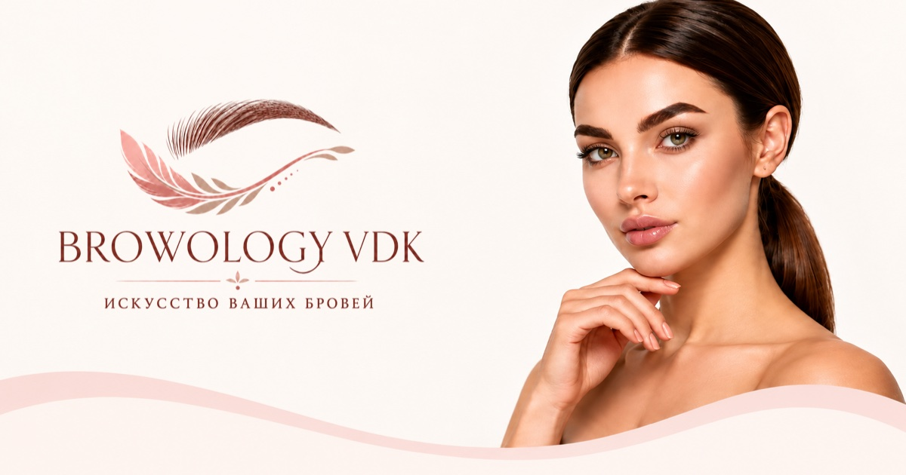

# Browology VDK

Лендинг для студии бровей **Browology VDK** во Владивостоке.

**🔗 Сайт:** https://sugrinovich.github.io/BROWOLOGY_VDK/



## О проекте

Одностраничный сайт для мастера по оформлению бровей. Его задача — познакомить клиента со студией, показать услуги и цены, работы и отзывы и привести к записи в один клик через WhatsApp.

Сайт выполнен в нежной пудровой палитре с сочетанием шрифтов Playfair Display и Montserrat. Он одинаково удобен на телефоне, планшете и большом мониторе.

## Разделы

* **Первый экран** — оффер и кнопка записи
* **О нас** — о мастере и четыре преимущества студии
* **Услуги** — пять процедур с описанием и ценами
* **Галерея работ** — примеры работ и переход в Instagram
* **Отзывы** — отзывы клиентов со ссылками на 2ГИС
* **Контакты** — телефон, WhatsApp, Instagram, адрес и карта

## Стек

* **HTML5** — семантическая разметка (`header`, `main`, `section`, `footer`)
* **CSS3** — Flexbox, CSS-переменные, `clamp()`, медиазапросы; методология **БЭМ**
* **JavaScript** — без фреймворков
* **[AOS](https://github.com/michalsnik/aos)** — анимации появления при прокрутке
* **Яндекс Карты** — виджет с расположением студии
* **GitHub Pages** — хостинг

Без сборщиков и зависимостей: проект работает как есть.

## Особенности

### Адаптивность
Три раскладки: телефоны (до 690 px), планшеты (691–980 px) и десктоп. Размеры шрифтов и отступов плавно масштабируются через `clamp()`, на широких мониторах ширина контента ограничена.

### Производительность
* Все изображения в **WebP** и подогнаны под реальный размер показа. Вес графики уменьшен с 11 МБ до ~0.5 МБ.
* Ленивая загрузка изображений и карты (`loading="lazy"`), размеры картинок заданы заранее, поэтому вёрстка не прыгает при загрузке.
* Иконки встроены в HTML как SVG вместо подключения иконочного шрифта.
* Шрифты и библиотеки хранятся в проекте, без зависимости от внешних CDN.

### SEO
* Мета-теги, `canonical`, `robots.txt` и `sitemap.xml`.
* **Open Graph** — карточка с картинкой при отправке ссылки в Telegram, WhatsApp и VK.
* Разметка **Schema.org** (`BeautySalon`): адрес, координаты, телефон и цены услуг для поисковиков.
* Favicon для браузеров и иконка для экрана «Домой» на iPhone.

### Доступность
* Контраст текста по стандарту **WCAG AA**.
* Видимый фокус при навигации с клавиатуры.
* Поддержка системной настройки «Уменьшить движение» — анимации отключаются.
* Альтернативный текст у всех изображений.

### Удобство записи
* Кнопки записи открывают WhatsApp с готовым текстом сообщения.
* Номер телефона кликабельный — на смартфоне сразу открывается звонок.

## Структура

```text
BROWOLOGY_VDK/
├── index.html
├── robots.txt
├── sitemap.xml
├── assets/
│   ├── images/      — фотографии и фоны
│   ├── icons/       — логотип, иконки, декор, favicon
│   └── fonts/       — Montserrat, Playfair Display
├── css/
│   ├── variables.css   — цвета и шрифты
│   ├── style.css       — основные стили
│   └── adaptive.css    — адаптив
├── js/
│   └── main.js
└── vendor/
    └── aos/
```

## Автор

Дизайн и разработка — [sugrinovich](https://github.com/sugrinovich)

## Лицензии сторонних ресурсов

* AOS — MIT License
* Иконки — [Font Awesome Free](https://fontawesome.com/license/free), CC BY 4.0
* Шрифты Montserrat и Playfair Display — SIL Open Font License 1.1
